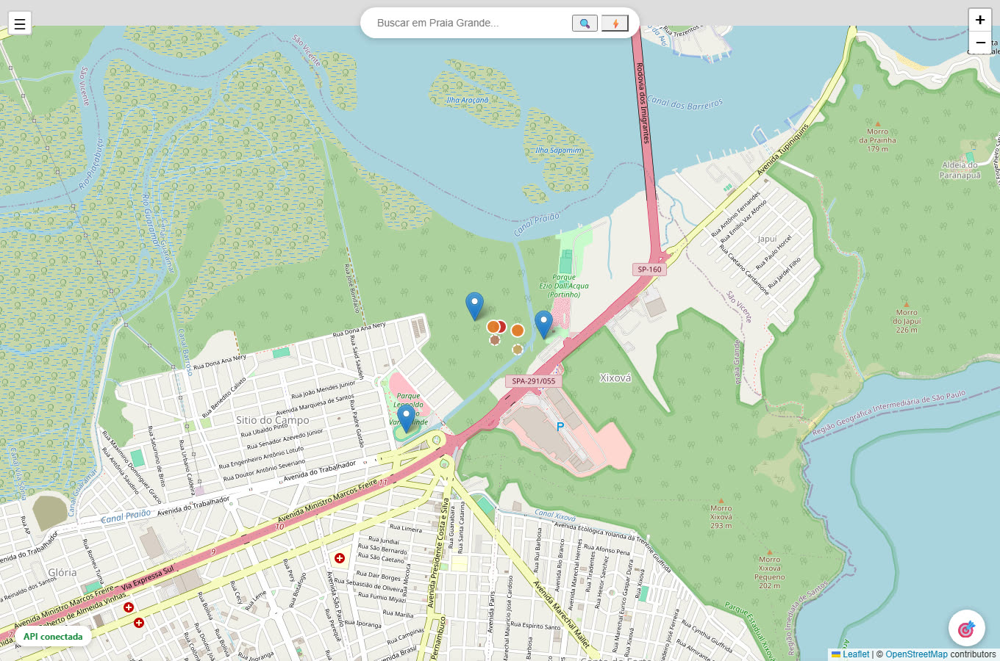
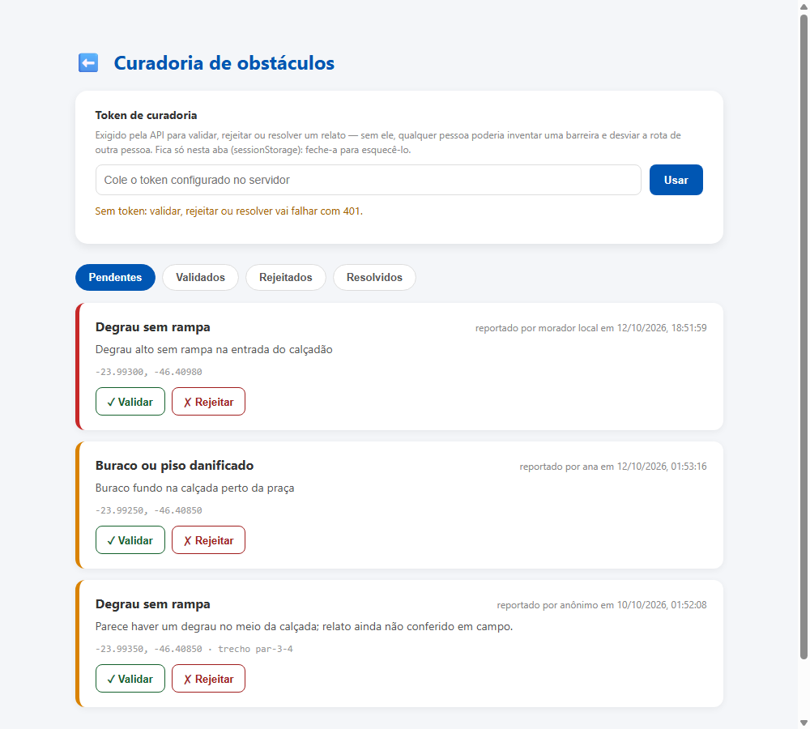

<div align="center">

# 🧭 MobiliTudo

**Mapeamento colaborativo de acessibilidade urbana em Praia Grande (SP), com cálculo de
rotas que contornam barreiras segundo o perfil de mobilidade de quem caminha.**

[](https://github.com/YasKarmem/MobiliTudo/actions/workflows/ci.yml)
[](LICENSE)


Projeto de extensão — Engenharia de Software, Faculdade Descomplica.
Alinhado aos ODS **9** (Indústria, Inovação e Infraestrutura) e **11** (Cidades e
Comunidades Sustentáveis).

</div>

---

## A ideia

Mapas convencionais respondem "qual é o caminho mais curto". Para quem usa cadeira de
rodas, essa é a pergunta errada: o caminho mais curto pode ter um degrau, uma calçada de
80 cm ou uma travessia sem guia rebaixada — e qualquer um dos três o torna inútil.

O MobiliTudo responde outra pergunta: **qual é o caminho que eu consigo percorrer**. A
rota devolvida costuma ser mais longa em metros e mais curta em barreiras.

<table>
<tr>
<td width="60%">

<p align="center"><sub>Mapa interativo, com locais acessíveis e obstáculos reportados pela comunidade</sub></p>
</td>
<td width="40%">

<p align="center"><sub>Curadoria: obstáculos só desviam rotas depois de validados</sub></p>
</td>
</tr>
</table>

### ✨ Destaques

- 🧭 **Rotas acessíveis de verdade** — A* ponderado por acessibilidade, não a distância mais curta, com parâmetros da ABNT NBR 9050
- 🗺️ **Dados espaciais reais** — PostgreSQL + PostGIS, índices GiST, consultas por proximidade e recorte de malha
- 🤝 **Colaborativo com curadoria** — qualquer pessoa reporta uma barreira; só um relato validado chega a desviar rota de alguém
- 🔒 **Curadoria autenticada e com limite de abuso** — token dedicado para validar/rejeitar/resolver, limite de relatos por hora
- 🕊️ **Autoexclusão de dado pessoal sem conta** — token de uso único devolvido no relato permite remover seu nome depois, sozinho
- 📜 **Licença AGPL-3.0** — projeto social, sem cobrar por feature; código sempre aberto, inclusive rodando como serviço
- 🏗️ **Arquitetura hexagonal** — domínio sem dependência de framework, testável em milissegundos, sem banco
- ✅ **138 testes automatizados** — 75 de domínio + 20 de integração (PostGIS real via Testcontainers) no backend, 43 no front-end
- 🩹 **Resiliente a falha** — sem backend, o mapa continua funcionando com o acervo local; sem o provedor padrão de tiles, troca sozinho

---

## Como subir

### Tudo de uma vez (Docker)

```bash
docker compose up --build
```

| | |
|---|---|
| Mapa | <http://localhost:8081> |
| API | <http://localhost:8080> |
| Documentação da API | <http://localhost:8080/docs> |

O banco já sobe com o esquema espacial e um recorte demonstrativo da malha viária entre o
Palácio das Artes e o Litoral Plaza — com uma obra no caminho curto, para que a diferença
entre a rota mais curta e a rota acessível apareça logo na primeira consulta.

### Só o mapa, sem backend

```bash
cd frontend/public
npx serve .                 # ou: python -m http.server 8081
```

O mapa funciona com o acervo local (`locais.json`). Rotas e relatos de barreira ficam
indisponíveis e dizem isso.

> **Não abra o `index.html` com dois cliques.** Páginas carregadas por `file://` não
> enviam cabeçalho `Referer`, e os servidores do OpenStreetMap recusam essas requisições
> com **403**. O mapa detecta a situação, troca de provedor e avisa — mas o jeito certo é
> servir por HTTP. Ver [docs/mapa-tiles.md](docs/mapa-tiles.md).

### Backend em desenvolvimento

```bash
docker compose up banco -d
cd backend
mvn spring-boot:run
```

| Variável | Padrão |
|---|---|
| `MOBILITUDO_DB_URL` | `jdbc:postgresql://localhost:5432/mobilitudo` |
| `MOBILITUDO_DB_USER` / `MOBILITUDO_DB_PASSWORD` | `mobilitudo` |
| `MOBILITUDO_PORT` | `8080` |
| `MOBILITUDO_CORS_ORIGENS` | `http://localhost:*,http://127.0.0.1:*` |
| `MOBILITUDO_CURADOR_INICIAL_EMAIL` / `MOBILITUDO_CURADOR_INICIAL_SENHA` | *(vazios — curadoria inacessível até serem definidos)* |
| `MOBILITUDO_LIMITE_OBSTACULOS_HORA` | `20` |
| `MOBILITUDO_LIMITE_LOGIN_HORA` | `10` |

Sem `MOBILITUDO_CURADOR_INICIAL_EMAIL`/`_SENHA`, a API sobe normalmente, mas não existe
nenhuma conta de curador para logar e validar, rejeitar ou resolver um obstáculo — a
curadoria fica inacessível até a variável ser definida, falha fechada, nunca aberta por
omissão (ver [docs/api.md](docs/api.md)). Essas variáveis só criam a *primeira* conta, uma
única vez; contas adicionais se cadastram já autenticadas, pela própria API. O
`docker compose` já sobe com credenciais de desenvolvimento
(`curadoria@mobilitudo.local` / `dev-apenas-nao-use-em-producao`); troque-as antes de
publicar a API em qualquer lugar acessível pela rede.

---

## Estrutura

Front e back são dois módulos irmãos, cada um dono do próprio build/tooling — o mesmo
padrão em ambos:

```
frontend/
  public/            site estático servível (mapa (Leaflet, sem build), sem o tooling abaixo)
    index.html  config.html  perfil.html  sobre.html  curadoria.html
    style.css   script.js    locais.json
    js/
      texto.js         escape de HTML compartilhado (proteção contra XSS)
      config.js        endereço da API, provedores de tiles e a sessão de curador
      mapa.js          camada base com tolerância ao 403 do OSM
      api.js           cliente REST, com degradação para o acervo local
      rotas.js         painel de rota acessível
      obstaculos.js    relato colaborativo de barreiras
  tests/               testes de js/*.js (vitest + jsdom)
  package.json

backend/               API Spring Boot + PostgreSQL/PostGIS (arquitetura hexagonal)
  src/
  pom.xml
  Dockerfile

docs/                  arquitetura, API, diagnóstico do erro 403 e capturas de tela
docker-compose.yml
```

`frontend/public/` é exatamente o que o nginx do `docker compose` serve — `package.json`,
testes e `node_modules` ficam fora desse diretório de propósito, para não publicar
tooling de desenvolvimento como parte do site.

---

## O que o cálculo de rota leva em conta

Perfis: **cadeira de rodas**, **mobilidade reduzida**, **deficiência visual** e **sem
restrições**. Cada um define o que é intransponível e o que apenas encarece o trajeto —
parâmetros baseados na ABNT NBR 9050:2020 (faixa livre de 1,20 m, rampa de até 8,33%).

| Atributo do trecho | Efeito |
|---|---|
| Degrau, escada, ausência de calçada | barreira absoluta para quem anda sobre rodas |
| Faixa livre abaixo do mínimo do perfil | barreira |
| Inclinação acima do máximo do perfil | barreira |
| Superfície não firme (areia, terra, grama) | barreira para quem exige firmeza |
| Travessia sem rebaixamento de guia | barreira para cadeira de rodas, custo para os demais |
| Inclinação excedente, estreitamento, obstáculos leves, iluminação | aumentam o custo |
| Piso tátil | reduz o custo para quem tem deficiência visual |

Obstáculos reportados pela comunidade só influenciam rotas **depois de validados**: um
relato não conferido não pode bloquear o caminho de outra pessoa. Validar, rejeitar ou
resolver um relato é feito na página **Curadoria de obstáculos** do mapa, com login de
conta de curador (e-mail + senha) — sem isso, qualquer pessoa poderia inventar uma
barreira e desviar a rota de outra pessoa, ou apagar uma barreira real do mapa.

Detalhes do algoritmo em [docs/arquitetura.md](docs/arquitetura.md).

---

## Testes

```bash
cd backend
mvn test                          # 86 testes de domínio, sem banco, segundos
mvn verify -DskipITs=false        # + 34 testes de integração contra PostGIS real (exige Docker)
```

```bash
cd frontend
npm install
npm test                          # 43 testes de js/*.js (config, api, meus relatos, escape de HTML)
```

O domínio é livre de framework, então as regras de acessibilidade e o algoritmo de rota
rodam em teste unitário comum. Os testes de integração cobrem o que o unitário não
alcança: migrações Flyway, mapeamento das colunas `geometry`, consultas espaciais, a
autenticação da curadoria, o limite de relatos por hora, a paginação e a rota ponta a
ponta pela API. Os testes de front-end cobrem o cliente HTTP (degradação para o acervo
local, estado online/offline, cabeçalhos de autenticação) e o escape de HTML que protege
contra XSS ao renderizar dado vindo da API.

---

## Documentação

- [Arquitetura](docs/arquitetura.md) — contextos delimitados, algoritmo de rota, persistência espacial, segurança
- [API v1](docs/api.md) — endpoints, paginação, autenticação da curadoria e códigos de erro
- [Privacidade e dados pessoais](docs/privacidade.md) — o que é coletado, por quê, e como remover seu nome de um relato
- [Erro 403 nos tiles do OpenStreetMap](docs/mapa-tiles.md) — diagnóstico e correção

---

## Contribuindo

O MobiliTudo é um projeto social: sem fins lucrativos, sem plano de cobrar por
nenhuma funcionalidade, e o valor dele cresce com quem mapeia uma calçada a mais ou
confere um obstáculo reportado. Toda contribuição é bem-vinda — veja
[CONTRIBUTING.md](CONTRIBUTING.md) para o fluxo de PR, convenções de código e como
rodar os testes antes de abrir um.

Encontrou uma vulnerabilidade de segurança? Veja [SECURITY.md](SECURITY.md) antes
de abrir uma issue pública.

## Licença

Distribuído sob a [GNU Affero General Public License v3.0 (ou posterior)](LICENSE).
Em resumo: o código é livre para usar, estudar, modificar e redistribuir — inclusive
rodando como serviço de rede —, e qualquer modificação distribuída ou oferecida como
serviço precisa continuar sob a mesma licença. É a cláusula que impede alguém de
pegar o MobiliTudo, fechar o código e vender de volta sem devolver nada à
comunidade — coerente com o projeto nunca ter cobrado por uma feature sequer.

---

<div align="center">

Desenvolvido por Yasmim Carmem Mariano Rocha · Engenharia de Software · 2026

</div>
